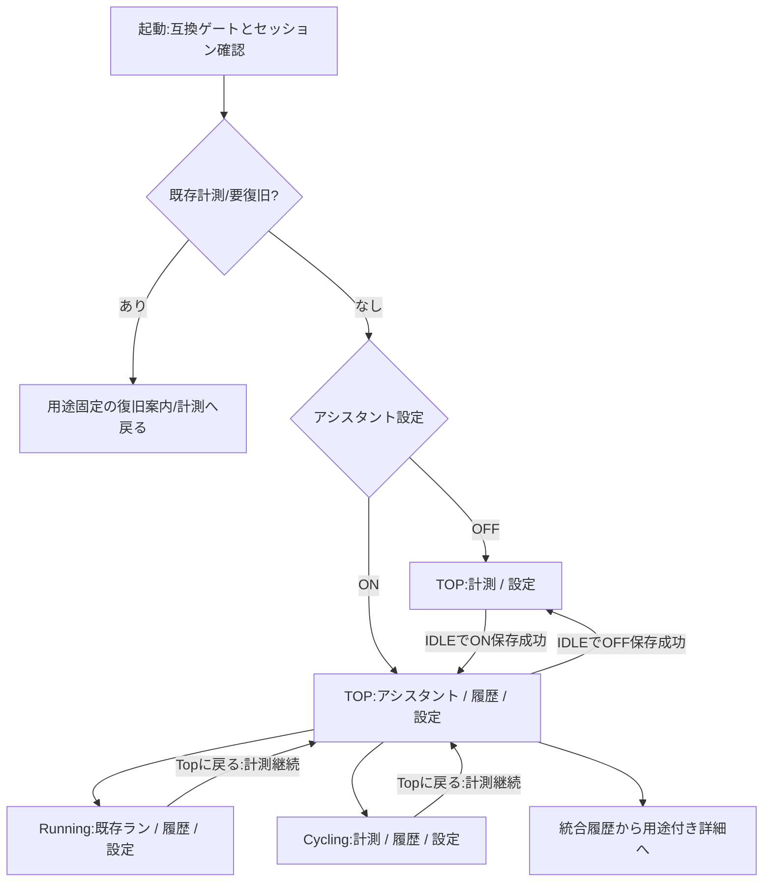

# 汎用計測基盤・運動アシスタント Phase 0（2026-11-25）

親Issue #97、Phase 0 #98。ブランチ `feat/activity-assistant`、起点main `c2aa35b1db07f9a7090c7ac6882a69138585f402`。本書は設計提案。アプリ本体・依存・DBを変更していない。以前のサイクリング設計/着手条件ではなく、マスターの2026-11-25指示を優先する。

**基本はシンプルな計測器。必要な機能をONにすると運動アシスタントになる。** 共通化を目的とした全面改修はしない。既存Runningを既定の互換プロファイルとして残し、用途の固定・非保存経路・Cycling接続口を追加する。

詳細：[セッション/保存/集計](activity-assistant-session-storage-20261125.md)、[実装順/変更ファイル/テスト](activity-assistant-plan-tests-20261125.md)。呼称はマスター＝最終意思決定/仕様承認/実機受入、Owner＝方針/進捗管理、開発担当＝Codex、独立レビュー担当＝固定SHA品質検証。

## 1. 実コードで確認した現状

| 領域 | ファイル・関数/クラス | 確認事実と新設計への意味 |
|---|---|---|
| Native入口/タブ | `src/app/_layout.tsx` `TabLayout`、`src/app/index.tsx` `RunScreen` | 現rootはラン/履歴/設定のTabs。`StorageCompatibilityGate`内。RunScreen mountはrestore/毎秒getActiveRunを起動するため、TOPで隠すだけでは汎用計測に隔離できない |
| UI/ナビ | `history.tsx`、`settings.tsx`、`run-detail.tsx`、`run-map.tsx`ほか | 相対routeと一部`../repositories`等のimportがある。画面本文を再設計せずroute group移動/import修正を機械的に行う必要がある |
| 計測サービス | `src/services/run-service.ts` `RunService`、`startLocationTask` | STARTはRunning設定→draft保存→GPS/音声/騒音/診断を起動。STOPはfreeze→GPS停止→SQLite完了→終了音声。単純流用すると汎用結果も保存される |
| GPS/背景 | `src/tasks/location-task.ts` `LOCATION_TASK_NAME`、`ingestLocationBatch` | 固定task `runjourney-background-location`からRunning repositoryへ直接配送し音声更新。Testは高頻度観測、その他は保存点経路。両者を保全する |
| GPS要求 | `run-service.ts` `trackingOptions` | High、通常5秒/5m、Test1秒/0m、Auto Stop時0m、foreground location service。要求は実配信Hzの保証ではない。Fitness指定はiOS用でありAndroid cycling判定ではない |
| RAM/保存 | `src/repositories/run-repository.ts` `RunRepository`、`LatestCheckpoint` | module単位のqueue/observationSession/pendingFinishがある。`database()`も単一cache。用途をglobal変数で切替える設計は誤保存につながる |
| SQLite | `database.ts`、`sqlite-store.ts` `SqliteStore`、`paged-store.ts` `SqlitePagedStore` | `runjourney.sqlite`、schema2。runs headerにeffective_distance/effective_timeがあり、GPSは別table。不変原本・ページ128行/64KiB・保護情報を持つ |
| 設定 | `src/repositories/storage.ts`、run/pace/clock等のsettings repository | 現Native設定はRunning DBのsettings table。TOPからそのまま使うと独立しない。既存key/値/backupを変えない |
| 履歴副作用 | `RunRepository.getActiveRuns/getTrashedRuns` | ごみ箱期限処理を呼ぶ。TOP統合履歴には使わない。`getHistoryPage`はheaderのみだがoffset、`SqlitePagedStore.list`はごみ箱も含むので無条件転用もしない |
| 時間/距離 | `src/utils/run-model.ts` `timeModel/effectiveEdges/effectiveRun`、`distance.ts` | 平均速度=有効距離/実走時間。Auto Stop/手動休憩を除外。距離精度50m、最小移動3m、上限12.5m/s。Running既定値を変えない |
| Auto Stop | `run-model.ts` `detectStop/RUN_CONTROL`、`movement-inference.ts` `inferMovement` | 速度・位置・精度・窓の定数が複数箇所に直書き。外側の1定数だけ変えてCycling対応済みとはできない |
| 音声 | `VoiceAnnouncement`、Native `RunAnnouncerService/VoicePolicy/PacePeriodicLedger` | 設定/キャッシュ/復旧文面はRunningに結合。初回本文だけ速度へ変えてもrecoveryでペース文へ戻る危険がある。queue/優先順位は維持しrendererを用途別にする |
| 診断/マーカー | `SensorDiagnostics`、`DetectorJournal`、Native `SensorDiagnostics/DetectorJournalStorage` | 既存noBackupFilesDir内の暗号化記録/MediaSession。汎用では自動起動しない。Runningの既存files/key/ARMED状態を移動・変更しない |
| 互換/同期 | `storage-compatibility.ts`、`sqlite-backup.ts`、`sync/native-queue.ts`、`sync/firebase.ts` | Production旧形式安全ゲート・iOS安全停止。backupは既存format/schema2、cloudはRunning source/queue/remote pathに結合。競技をUIだけで切り替えない |
| Web | `_layout.web.tsx`、`index.web.tsx`、native専用routeの`.web.tsx` | 独立の既存Web分析UIを保持。今回Android優先案。Web/Cycling cloudやiOS互換完成は主張しない |

旧Phase 0調査を新TOP構成へ読み替え、今回必要な接続点だけ再確認した。649 tests・既存保存互換/Native証拠は基準mainの検証であり、この未実装設計の動作成功ではない。

## 2. TOPとRunningを分ける最小のroute案

```text
src/app/_layout.tsx             Root Stack + 現StorageCompatibilityGate + bootstrap
src/app/index.tsx               初期振分け（通常/top、要復旧時は復旧案内）
src/app/top/_layout.tsx         TOP専用Tabs
src/app/top/index.tsx           OFF:計測 / ON:アシスタント（同一route）
src/app/top/history.tsx         ON時だけタブ/routeを許可
src/app/top/settings.tsx        TOP設定だけ
src/app/(running)/_layout.tsx   既存Running Tabsをほぼそのまま保持
src/app/(running)/run.tsx       旧index.tsx、タブ名は既存「ラン」
src/app/(running)/history.tsx   旧/history（URL維持）
src/app/(running)/settings.tsx  旧/settings（URL維持）
src/app/(running)/...           既存detail/map/trash/診断/cloud等
src/app/cycling/_layout.tsx     Cycling専用Tabs
src/app/cycling/index.tsx       計測
src/app/cycling/history.tsx     履歴
src/app/cycling/settings.tsx    設定
src/app/cycling/detail.tsx      recordIdをCyclingへ固定
```

Expo Routerのroute groupはURLに現れないため、既存`/history`・`/settings`・`/run-detail?id=...`等を維持できる。唯一旧`/`はTOP起動へ変わり、Running計測を`/run`へ置く。既存relativeリンク/旧通知deep linkはroute契約試験で全件照合する。移動に伴う相対importはaliasへ機械修正、画面内容/操作/色/表示階層を再設計しない。`data-transfer`等も漏らさずRunning groupへ所属させる。helpersは`src/app`の外へ置く。

RootにTOP用タブを常時表示したまま内側にもタブを出す構成は採らない。TOPか競技Tabsのどちらか一組だけ表示する。Running/Cyclingの左上に小さい「Topに戻る」を追加。Runningの未保存PACE設定は既存`requestPaceLeave`を通す。Topに戻る/Android戻る/画面unmountをSTOP・reset・saveの契機にしない。

Web既存`_layout.web/index.web`は保全し、移動する既存web相対import/redirectも同じURLで照合。新Native専用routeにはWebでの安全な入口/redirectを用意し、Native SQLiteへ接続しない。iOSの既存互換ゲートをTOP追加で迂回しない。



## 3. UI案（未実装）

```text
OFF: RunJourney                       ON: RunJourney
     距離  1.25 km                          ランニング  >
     時間  00:12:34 ※時間ONだけ             サイクリング >
     [開始] / [停止] / [リセット]           ※計測中は「Running 計測に戻る」
     [計測]         [設定]                 [アシスタント] [履歴] [設定]

TOP設定                               競技内部
運動のアシスタントとして使う [ON/OFF]   [Topに戻る] ランニング
時間計測 [ON/OFF]                     （既存の画面とタブを保持）
ON時:「アシスタント利用中は時間計測が必要です」
      時間switch ON固定/操作不可
計測中:「計測終了後に変更できます」両switch操作不可

統合履歴
[すべて | ランニング | サイクリング]
今週 / 今月 / 全期間
運動時間 / 回数 / 運動日数（主）
合計距離 + 競技別距離/時間（従）
日時・競技・距離・実走時間・競技別平均指標 > 詳細
片DB失敗時:「Cyclingを取得できません。Runningのみ表示」
```

汎用OFF画面にペース/速度/目標/Auto Stop/音声/運動履歴/EXP等は出さない。無効機能はサービスでも実行禁止。位置品質不足や復旧に必要な状態案内は「機能を利用していない」のとは別であり隠さない。

## 4. TOP設定の提案（マスター承認待ち）

新規インストールはアシスタントOFF・汎用時間OFFを推奨。更新は既存DB/設定/legacy痕跡又はdraftがあればアシスタントON（時間ON固定）を推奨し、初回に「ランニングはアシスタント内に移動しました」と一度説明する。既存データを移行・書き換えて判別しない。判別不能/設定破損はOFF初期値を上書きせず、再確認可能な安全画面とRunning入口を保持し、新STARTを保留する。

保存案は独立`top-settings.v1.json`（app-private・小容量の原子的保存）。既存Runningの`SettingsStorage`を流用しない。値は`version/assistantEnabled/genericTimeEnabled/onboardingSeen`。有効時間設定は`assistantEnabled || genericTimeEnabled`の派生値とし、ON固定中にもgenericTimeEnabledを上書きしない。OFFへ戻すと元の汎用時間設定へ戻る。TOP設定は競技backupに紛れ込ませない。

| 現在 | 操作 | 結果 |
|---|---|---|
| IDLE/OFF | assistant ON | 保存ACK後に3タブ、時間ON固定。競技設定・履歴無変更 |
| IDLE/ON | assistant OFF | 保存ACK後に2タブ、genericTimeEnabledを再適用。競技データ削除なし |
| IDLE/OFF | 時間ON/OFF | 汎用設定だけ保存、表示を変更 |
| ON | 時間OFF操作 | UI無効化＋サービス拒否、理由を表示 |
| STARTING/計測/要復旧/STOPPING/保存失敗 | TOP両設定変更 | 拒否。保存・終了処理完了まで用途/設定を固定 |
| 設定書込み失敗 | ON/OFF操作 | 見かけだけタブを変えず旧設定を維持、再試行を表示 |

OFFのdeep linkで競技内部へ入ろうとした場合、通常はTOP設定へ案内し、勝手にONにしない。ただし更新前から残る計測の復旧入口は設定値より優先して安全に提示し、その完了まで新用途STARTを禁止する。アシスタントOFF/再ONで履歴や競技設定を初期化しない。

## 5. 汎用計測案（マスター承認待ち）

距離と任意の時間、開始/停止/リセットのみ。Auto Stopなし、MVPに一時停止ボタンを追加しない。停止は結果確定、結果はRAMでその場表示、リセットしてから次の開始。停止中のGPSは採用せず、計測中リセットは不可。時間ONなら停止までの経過を表示し、信号待ちも含む。時間OFFでもGPSの時刻・単調時計・重複検査を保持する。

High/5秒要求・0m距離条件、距離m→1km以上はkm、小数2桁を候補とする。GPS精度50m/3m最小辺は既存部品を利用、長い欠測では接続辺を切る案（15秒候補）。汎用上限は地上移動向け100m/s候補であり、汎用性の対象が航空まで含むかは承認点。根拠は地上移動の広い包絡値で、精度を実証した値ではない。閾値超えを受理せず品質状態として表示し、座標/欠測距離の補完はしない。Runningには適用しない。

運動DBを開かず、保存sinkなし、Voice/PACE/目標/AdaptiveAudio/MediaSessionマーカー/運動統計/cloudを呼ばない。GPSのlocation Foreground Serviceだけ中立通知「距離を計測中」で起動する。時間OFFを録音やセンサー採取の許可と解釈しない。背景/画面OFFは維持を目指すが、OSの強制終了/再起動で無欠測を保証しない。

復旧用の小さい暗号化checkpointは履歴と区別する。活動中だけ保持する位置anchor等を含み、STOP/明示reset後は座標/結果を残さない。詳しい順序・上限・失敗時は[保存設計](activity-assistant-session-storage-20261125.md)参照。

## 6. Cycling案（マスター承認待ち）

距離/実走時間/壁時計経過/現在速度/平均速度/軌跡。平均速度は既存Runningと同じ有効距離÷実走時間、停止/手動休憩除外。現在速度は有効provider速度を優先、欠落時は有効辺速度の直近3点・最大10秒medianを候補とし15秒更新なしで「--」にする。最大速度はGPS spike評価のコストがあるため初期MVPに追加しない。

| 用途 | GPS要求/保存候補 | 距離・品質候補 | Auto Stop |
|---|---|---|---|
| Running | 現High、通常5秒、Test1秒、保存gate等を完全維持 | 50m/3m/12.5m/sと現全フィルター維持 | 現設定・全定数・アルゴリズム維持 |
| 汎用 | High/5秒/0m、履歴保存なし | 50m/3m/100m/s、15秒gap切断（未承認） | 利用不可 |
| Cycling | High/1秒/0m要求、原観測と間引き保存を分離、保存5秒候補 | 50m/3m/30m/s（108km/h）、15秒gap切断候補 | 既存アルゴリズム、観測上限も30m/sへ分離。その他は現値を評価基準。初期OFF推奨 |

30m/sは45km/h超の正常自転車走行を除外しないための工学的候補で、実走妥当性は未検証。低速登坂とGPS driftはGPSだけで区別不能な範囲があり、現0.35m/s等の静止閾値をそのまま正解と主張しない。まず初期OFFで機能を提供し、シミュレーターと正解ラベル付き試験を経てCycling定数だけを調整する案。Runningの閾値は変更しない。

Cycling音声は5分**実走時間**ごと・初期ONを候補とし、例「5分経過しました。走行距離は2.4キロ、平均時速は28.8キロです」。初期項目は実走時間→累計距離→平均速度。PACE貯金/遅れ・フル換算は利用不可。開始/終了/停止再開の文言、現在時刻等の追加設定は別承認。既存queue/フォーカス/チャイム/優先順位を再利用するが、初回/復旧/再試行/終了の全rendererを用途で束縛しRunning語彙を混入させない。

## 7. マスター判断が必要な事項

確定仕様を再承認要求するものではなく、指示で提案を求められた未決部分。

1. 新規OFF/時間OFF、既存更新ON、OFF復帰で元の汎用時間設定を復元する初期化案。
2. 汎用の対象速度範囲（地上移動100m/s案）、単位表示、一時停止なし・停止後reset必須、復旧gapの明示案。
3. Cyclingの30m/s/1秒要求/5秒保存・Auto Stop初期OFFと精度評価、現在速度median、5分音声文面/項目。
4. 統合サマリーは端末IANA timezone・週の開始月曜・開始日帰属・全期間初期表示の案（詳細は保存設計）。
5. Cycling cloudはMVP対象外、競技付きbackupをMVPに含める案。既存Running同期/backup互換は必須維持。
6. Android優先・Web分析UI/iOS安全停止維持、checkpoint/Native制御追加を含む実装順、および競技終了後に汎用を開始する際の残音声取消契約の承認。

回答を待つ間に上記を実装したり、重要な値を確定したりしない。Phase 0提出後、次の実装開始指示まで停止する。

## 参照した一次資料

SDK57のインストール済みversionをpackage.jsonで確認。資料の推奨patchが違っても今回依存更新はしない。
[Expo Location SDK57](https://docs.expo.dev/versions/v57.0.0/sdk/location/)（要求間隔/OS終了制限）、[SQLite SDK57](https://docs.expo.dev/versions/v57.0.0/sdk/sqlite/)、[Routerのネスト](https://docs.expo.dev/router/advanced/nesting-navigators/)、[route notation](https://docs.expo.dev/router/basics/notation/)。実コードの数値と提案値を上記で分離した。
