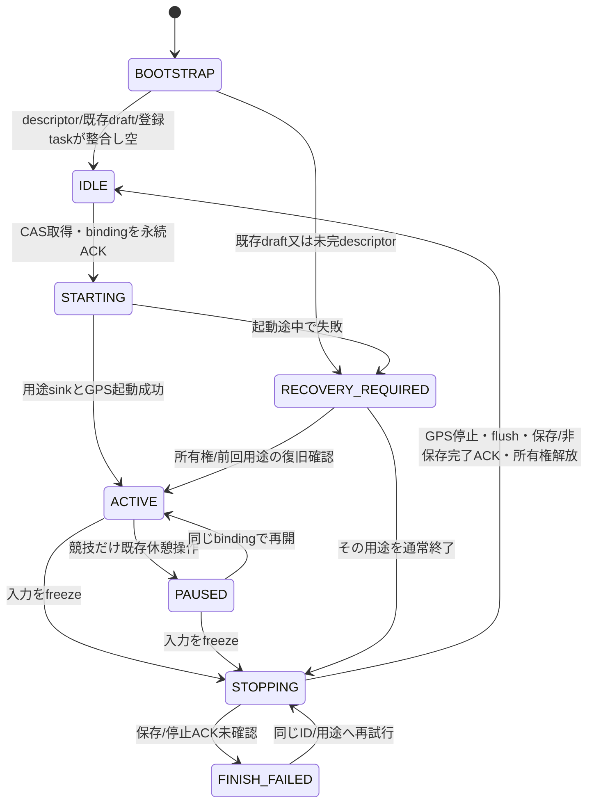

# 用途固定・DB分離・統合履歴の詳細設計（提案）

親#97 / Phase0 #98、起点`c2aa35b`。[TOP/製品設計](activity-assistant-phase0-20261125.md)と合わせて読む。以下の型名・パス・値は実装予定であり、新しいコード/ファイルを作成したという報告ではない。

## 1. 最小限の共通化

`MeasurementProfile`は`generic/running/cycling`、競技の識別は`ActivityKind=running|cycling`。用途ごとの保存/表示/GPS/Auto Stop/音声の能力を列挙する。UIだけの非表示ではなく開始/保存/通知/backup APIでも拒否する。

```text
MeasurementProfile
  id/version
  capabilities: history, autoStop, pause, sportVoice, pace, map,
                backup, cloudSync, testSensorMarkers
  gps: request + admission + distance + persistence parameters
  movement: algorithm version + constants
  voiceProfileId + displayProfileId
  persistence: none | running DB | cycling DB

SessionBinding（START時に検証・固定）
  sessionId, generation, purpose, recordId?, profileVersion
  persistenceKind, databaseKey?, settingsSnapshot, parameterSnapshot
  voiceProfileId, startedWall, startedMono, bootId, status
```

DB名/パスを外部routeや任意文字列から採用せず、用途と既知enumの対応を検証する。アシスタントOFFや`generic`から運動保存APIを呼ぶと無効。Runningの既存設定がONでもgenericへ流入しない。CyclingはPACE/フル換算等を能力として持たない。

既存`RunRepository/RunService/database()/SettingsStorage`はRunning既定facadeとして維持する。現在のmodule-level RAM/queue/checkpointを必要な箇所だけinstanceへ束縛し、Cyclingへ明示的に生成する。`currentActivity`や`currentDatabase`という可変globalに旧関数の保存先を委ねない。`SqliteStore`のモデル計算ポリシーだけを引数化しRunningが既定。Running schema/保存key/record JSONへactivity列を追加しない。旧テストや旧呼出しの引数はそのまま動く。

共通の距離/時間/Auto Stop処理はprofile引数を受ける小さいseamを追加する。`inferMovement`内の複数hardcode、観測window/admission/persistence、`effectiveEdges`、保存header再計算、再解析、voice recoveryまで値を一貫させる。片側だけCycling上限にして後でRunning値で再計算する事故を試験する。Running profileの値・分岐結果・保存時刻/順序は同入力で一致させ、既定値を変えない。

汎用は同じGPS変換/有効辺計算部品を使う専用accumulatorと非保存sink。`RunService.startRun()`や`RunRepository.saveActiveRun()`を汎用開始に使わない。全機能OFFのために全クラスを再実装する案も採らない。

## 2. 排他制御と復旧

UIのbusy/JS Promiseだけではheadless callback・プロセス復旧の排他を証明できない。app sandbox内の新しいNative `SessionCoordinator`を1つ設け、小さなAtomicFileのdescriptorと世代番号を単一workerで直列化する。全JS runtime/ServiceのSTART/STOPを同じ入口へ集約し、ファイルロック/単一Native所有者で多重書込みを防ぐ。ファイルは履歴DBではない。既存RunningのSTART/STOP順序を包むadapterを先に検証する。



IDLE以外の新用途開始・用途設定変更を拒否。別競技タブへ閲覧だけ遷移してもSTARTは無効で「Runningの計測中です。計測に戻る」を表示。Topに戻る・Android戻る・背景復帰・画面unmountではstop/resetを呼ばない。二重STARTは同一要求IDなら同じ結果、異用途なら拒否。終了中/flush失敗は所有権を解放せず、保存済みか不明なまま別用途へ進まない。

Runningの通常GPS/draft保存は、診断ログや画面の失敗で中断させない。coordinator制御ファイルが失敗した場合は既存計測のRAM所有権/保存を維持し、新STARTを止め、再起動時は既存draft/登録taskを照合する。診断失敗と排他確立失敗を同一視しない。稼働中の診断失敗は引き続きRUNを止めない。

### 旧版からの更新・途中失敗

1. 新descriptorがなくてもRunning DBの`active_run`/headerと登録taskを読み取り専用で先に確認する。起動判定のため全GPSをロードしない。
2. 旧draftがあるならそのIDをRunningへ固定するdescriptorを作り、`RunService.restoreActiveRun()`へ渡す。新用途STARTより先に、従来と同じ復旧/保存再試行を行う。既存draftや設定に用途fieldを追記しない。
3. descriptor/DB draftが食い違う、両DBにdraftがある、未知用途/パス/プロフィールversion/clockがある場合は`RECOVERY_REQUIRED`。推測で片方を削除・統合・保存先変更しない。
4. Running STOPのSQLite保存成功とdescriptor解放の間に落ちた場合、`completed`同IDを照合して重複保存を避け、GPS停止を再確認して所有権だけ解放する。逆にdescriptorだけ消えてdraftが残る場合は新規開始を許可しない。
5. 旧appの既存時間モデルをcoordinator都合で書き換えない。新汎用checkpointの不明gapは別の復旧品質として表示する。

### GPS配送のfence

Runningの既存task名は維持し、新規generic/cyclingは固定の用途別taskをmodule scopeで登録する。登録されることと計測開始は別。OS上の稼働登録は同時に1用途だけ。handlerはNativeが検証したbinding/generationを取得し、用途一致・startedAt以降・受信済み時刻・順序・重複を検査する。UIの選択値を参照しない。

callbackには開始requestのtokenが入ると仮定しない。処理開始時にbindingをcaptureし、commit直前にもgeneration/statusを検証する。STOPPING/旧用途/旧世代は拒否。遅れて来た同用途旧batchも開始前のGPS時刻を排除する。受信遅延とGPS欠測を区別し、未受信の値や未来点を利用しない。既存Runningの入力順序/フィルターを変更する新規規則は、無断で追加せず互換adapter試験で扱う。

## 3. 汎用checkpointは履歴ではない

- 新app-private `noBackupFilesDir/activity-session-v1/`に1つの現在descriptor/checkpointのみ。上限32KiB、座標は直近anchor等最大3点、累計距離・重複防止cursor・時間anchor・品質/欠落数。全軌跡/セッション一覧/終了履歴は保持しない。
- 座標等は新aliasのKeystore AES-GCMで暗号化・認証し、AtomicFileで原子的に置換。既存diagnostic key/ファイルを流用・移動しない。暗号primitiveの抽出だけ検討し、診断の稼働/保持期限へ依存させない。settingsファイルには座標を入れない。
- 既存LatestCheckpointの「in-flight1＋latest1」を参考に、5秒ごと/状態変更で保存。seqと累計を同一checkpointで確定し、復旧後に距離を二重加算しない。通常のGPS ingestで毎点fsyncしない。時間OFFでも内部単調時計は保持。
- プロセス/端末再起動時はbootIdと最後の確実な受信時点を照合。不明区間に架空距離を接続せず、汎用時間も「中断区間を含まない値/欠落あり」と表示して明示再開する案。OSが終了後に自動再起動するとは保証しない。
- 汎用STOPはGPS停止と最終RAM値を確定し、coordinatorを座標なしのIDLEへACKした後だけ別開始を許可する。結果の距離/時間は画面RAMで表示し、アプリ再起動で復元しない。明示resetもこの新規一時領域だけに作用する。運動DB・backup・既存診断ファイルへ触れない。
- checkpoint/容量/鍵エラー時は欠落を成功扱いせず警告する。通常の運動RUN保存を巻き添えにしない。汎用RAM計測は継続可でも復旧保証なしを表示し、所有権が不明なら新用途開始を禁止する。

## 4. DBと設定・backup・cloudの境界

| 用途 | 永続履歴 | 設定 | 読書き経路 |
|---|---|---|---|
| Running | 既存runjourney.sqlite/schema2 | 既存settings key/値を完全維持 | 既存facade、明示Running binding |
| Cycling | 新runjourney-cycling.sqlite | 新DB settings、用途付き新key | 同じSqliteStore/保存engineをCycling policyで生成 |
| 汎用 | なし | TOP設定の汎用時間のみ | 履歴sink/DB openなし、活動中checkpointのみ |
| TOP | 履歴DBなし | 独立top-settings.v1.json | 新atomic設定port。Running backup/restoreから独立 |

Cyclingも原本/ページ/保護/ごみ箱/グループを共通schemaで保持する。既存の`run_id`等の内部名を理由にRunning schemaを改称しない。Cycle再計算も同じCycle profileで行う。factory/cache/queue/checkpointはDBとbindingごと、callごとに用途を推測しない。

旧Running backupは従来formatのままRunningの既存decoder/復元処理だけへ。Cyclingは新`runjourney-activity-backup` envelopeに`activity=cycling/schemaVersion/profileVersion`とpayload/hashを付ける案。旧Running backupをCyclingへ、新Cycling envelopeをRunningへ渡すとdecoderで拒否。UI表示だけに頼らない。TOP復元で両競技をまとめて上書きする処理は追加しない。実データの復元/移行試験は今回行わない。

Cycling cloudは初期MVPから除外を推奨。既存Running cloud transport/remote schema/queue keyを変更しない。現在のRunning cloudは`runjourney/{uid}/pagedRuns`等へ接続し、ローカルapplicationIdだけでremote領域が分かれる設計ではない。従ってCycling/Testの新自動送信を追加しない。将来実装時にenv/activity/uid付き別remote領域・認証rules・衝突対策を別承認し、Emulator合成データで検証する。今回はcloudへ接続/書込みしない。

Native音声のqueue/ledgerやTest診断もrecordId単独で混同しない。Runningの従来wire ID/ファイル名は維持し、Cycleは`cycling:<id>`等のnamespaceとsessionIdをadapterで付ける。通知の初回/再試行/recovery/終了のprofileが一致することを検証し、既存Native enum/ledger互換を無断変更しない。汎用では音声Service/MediaSessionを起動しない。

競技STOP後の終了音声が残る場合も考慮する。汎用STARTへ移る境界では前用途の通知/再試行を明示取消し、Native取消ACKを確認してからgenericをACTIVEにする案。取消不能なら新開始を保留し、元RUNの保存成功は取り消さない。これは新しい用途間の取消契約としてマスター承認待ち。単にgenericが新通知を生成しないだけで、前用途の残音声が漏れないと主張しない。競技間の終了音声も元profileを保持し、別競技の値へ再解釈しない。

## 5. 統合履歴はメタデータだけを読む

新`ActivityHistoryReader`/`ActivitySummaryService`は読み取り専用。`RunService.getHistory()/RunRepository.getActiveRuns()`は全GPS/ごみ箱期限処理があるため禁止。既存`SqliteStore.summaries`も`atomic()`経由でBEGIN IMMEDIATEするので、そのまま「厳密読取り専用」のTOP readerとは呼ばない。

generic計測処理のDB open/writeゼロは、共通bootstrapで旧所有者を確認し終えた後の処理境界で測る。起動安全確認の既存draft header/互換確認まで「読取りゼロ」と偽らない。ただし起動確認に履歴全件/GPSや期限処理は使わず、generic自体はRunningの通常storeを開かない。

Androidでは新しいbounded metadata readerを提案する。既知DBの既存fileにだけOSの`OPEN_READONLY`で接続し、schema versionと必要な列を確認、許可したSELECTだけを実行する。Nativeの一般SQL実行口は公開しない。存在しないCycling DBは0件（readで新設しない）、存在するDBの読取失敗/未対応schemaはエラー。Production互換ゲートはTOPで迂回しない。新しい列/index/PRAGMA user_version変更が必要なら実装前にマスターへ相談する。

取得列はid/started_at/ended_at/effective_distance/effective_time/status/trashed_at等だけ。completed・非trashだけを対象とする。表示IDは`{activity,id}`、全route/編集/削除/復元/backupにも用途を明示する。履歴詳細は対応競技の既存経路へ渡し、統合画面に更新APIを増やさない。グループ表示で元RUNとグループを二重集計せず、元completed RUNのheaderを1件ずつ数える。

ソートは`startedAt DESC → activity固定順 → id固定順`。各DBはstartedAt/idのkeyset cursorを使い、2本の小さいiteratorでmergeする。表示要求50件、DB page128行/64KiB以内、リスト保持は最大500件程度のwindow案。OFFSETで大量履歴を全走査したり、100,000行/GPSをJSへ一括展開しない。同日時/同IDも別競技として表示する。既存indexを利用し、同時刻大量件の性能を測ってから追加indexの必要性を判断する。

時刻順は文字列の大小だけで決めない。既存importがoffset付きISOを持つ場合も実instantへ正規化して比較する。canonical UTCの既存index fast pathと、非canonical時の読取り専用SQL式/Native正規化sortを検証する。後者はSQLite側の一時領域やsortコストも測定する。新indexや保存日時の書換えで解決せず、性能不足なら承認事項として報告する。

履歴ページは長いtransactionを保持しない。取得後の新規記録はrefreshで先頭へ、削除/補正/グループ解除/復元の成功後とfocus復帰で両readerをinvalidateする。ロード中の古いrequestはgenerationで捨てる。既存更新箇所の通知漏れはfixtureで確認。期間/競技filter変更でも新generationにする。

片方が失敗した場合、正常側は表示し、失敗競技名・再試行・取得範囲を表示する。全部0件と片側失敗を混同しない。詳細の用途が失敗側なら別DBで同IDを探して代用しない。

## 6. 統合サマリーの定義（承認待ち）

- 初期表示は全期間、切替は今週（月曜00:00）/今月（1日00:00）/全期間。
- 端末のIANA timezoneを集計開始時に固定し、期間は`[開始instant,次開始instant)`。timezone変更/日付跨ぎで再集計する。DSTの日を86,400,000ms固定加算しない。Android java.timeのZoneId/LocalDateを利用する案、計測端末や競技をまたいでも同じ集計zoneを使う。
- 期間への帰属は開始日時。跨日RUNの時間をGPSなしで日割りせず、そのRUNの全実走時間を開始日に帰属させる。運動日数は**開始日基準**のdistinct LocalDateで、同日Running/Cyclingを1日にする。実際に動いた全日数の厳密推定とは区別し、UIに開始日基準と明示する。
- 総運動時間＝両競技のeffective_time合計、回数＝completed非trashの元記録数、運動日数＝上記集合の和集合。距離は総和と競技別、時間も競技別。平均ペース/速度を競技横断で単純平均しない。0距離や0時間は保存済みheaderを尊重し、指標の計算不能は「--」。不正/非有限headerを成功集計に混ぜず件数と不完全状態を示す。
- サマリーはNative workerで同じheaderをcursor走査・逐次集計し、GPSを参照しない。各DBの短時間read snapshotを取り、sourceごとのasOfを表示する。2DB同時に完全に同じ瞬間のsnapshotだと偽らない。
- snapshotの保持は最大10秒/32,768日などの安全budget案。WAL肥大/timeout/中止ならreaderを閉じて部分結果・再試行にし、元DBを変更しない。日集合は上限付き、100,000件以上でもRUN配列は保持しない。UIメモリ/Native時間/WALを合成測定してbudgetを確定する。
- 片DBエラー・期限・不正header等で未完なら`complete=false`、成功競技別小計だけを表示。部分和を「総運動時間/総回数/総運動日数」の完全値として強調しない。前回完全値を表示する場合も「前回集計」と時刻を付ける。キャッシュはRAMのみ/競技revision付きで、新しい履歴専用DBを作らない。

## 7. 安全性の受入境界

Running DBのDDL/設定key/既存backup/cloud schemaに変更が必要と判明したら、手を入れる前にマスターへ根拠/影響を提出する。iOS互換未完・Production旧形式ゲート・OS終了後の欠測を解決済みとしない。

設計で原子性/耐障害性を提案したことは、実装・検証が済んだ証拠ではない。重大な誤保存（generic→運動DB、Running→Cycle DB）を故障注入で再現できないことが後続の必須受入。現段階の検証は文書/ソース照合のみ。

一次資料：[SQLiteDatabase OPEN_READONLY](https://developer.android.com/reference/android/database/sqlite/SQLiteDatabase#OPEN_READONLY)、[AtomicFile](https://developer.android.com/reference/android/util/AtomicFile)（原子的置換は排他lockとは別）、[SystemClock](https://developer.android.com/reference/android/os/SystemClock#elapsedRealtime())。これらを使った新Native実装はまだない。
