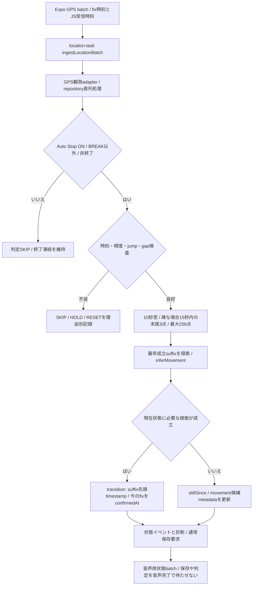
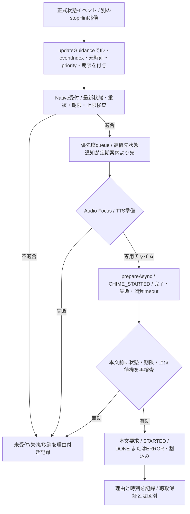

# Auto Stopフローの正本：main a822da8

#52の資料成果物。対象は`detectStop` detector.version=4 / `MOVEMENT_ALGORITHM=window-v5-stop-dwell`。加速度/ジャイロは診断専用で、この判定へ入力しない。`detectStopV3`の残存定数やオフライン短窓候補を現行条件へ混ぜない。本書は仕様可視化であり、閾値・判定を変更しない。

## 現mainの入口・状態遷移

| 正式状態 | 遷移 | 根拠/禁止 |
|---|---|---|
| RUNNING | AUTO_STOP | 最早stationary suffix。狭い静止またはbounded dwell |
| AUTO_STOP | RUNNING | 最早moving suffix |
| RUNNING/AUTO_STOP | BREAK | 手動操作・break ON |
| BREAK | RUNNING | 手動再開のみ。sensorイベントでは解除しない |
| 同状態/古い時刻/無効時刻 | 変更なし | transitionが拒否。候補metadataは正式状態ではない |

## 閾値・時刻・欠測（現コードとの対応）

| 条件 | 現mainの実装値・動作 | コード |
|---|---|---|
| 入力品質 | 有限のfix時刻・座標、accuracy 0〜20m。確定境界より古い/前fix以下はSTALE_FIX | [usableObservation/inferMovement](../src/utils/movement-inference.ts)、[detectStop](../src/utils/run-model.ts) |
| gap/jump | 前良好fixから15秒超はgap。gapなしでedge速度12.5m/s超はHOLDし良好lastを置換しない。不良精度＋15秒超はRESET | 同上detectStop |
| 窓 | 原則10秒。3点未満なら最大15秒内の末尾3点。時刻重複除去・sort・最大256点、異常辺を除外。gap時は現在点だけ | 同上detectStop |
| 共通観測期間 | 5秒以上、2点以上、全辺速度が有限かつ12.5m/s以下。5秒の後に別の5秒待機を加える方式ではない | 同上inferMovement |
| 狭い静止 | spread≦3m、始終点変位速度≦0.35m/s。suffix先頭edge≦0.5m/sも必要 | 同上inferMovement/detectStop |
| bounded dwell | 8秒以上、5点以上、spread≦8m、変位速度≦0.35m/s、coherence≦0.35、movingでない。先頭edgeの狭い静止条件は免除 | 同上 |
| 移動 | 5秒以上、3点以上、変位速度≧0.7m/s、coherence≧0.7、0.5m/s以上の移動edge比≧0.7、先頭edge≧0.5m/s | 同上 |
| 時刻 | 根拠先頭timestampへ遡及、confirmedAtは判定fix時刻。配送/JSキュー/音声の時刻は別。速度中央値は診断値で、GNSS speedだけで停止を決めない | [transition/detectStop](../src/utils/run-model.ts) |

spreadは点間最大距離、coherenceは始終点変位÷経路長。ジッターやUターンが誤判定を起こし得ることと、閾値の仕様化を区別する。#28/#43で改善・評価を追跡し、実停止の独立ラベルがない部分を正確率にしない。

## 音声・専用チャイムの別フロー

停止兆候は正式判定とは独立した`stopHint`（低速/狭い広がりの連続suffix）で、30秒cooldownがある。`STOP_CANDIDATE_*`の空文診断は発話しない。停止確定/再開確定はpriority100、15秒期限、最新状態・eventIndex一致が必要。兆候案内は80/4秒。専用チャイムは原子的な完了待ち、共通チャイムは取消可能、手動BREAK/RESUMEはチャイムなし。詳細は[現音声正本](voice-current.md)、[JS updateGuidance](../src/services/voice-announcement.ts)、[Native queue/playChime](../modules/run-announcer/android/src/main/java/app/runjourney/announcer/RunAnnouncerService.kt)。

`stopHint`は末尾4秒・最大6点から連続低速suffixを選び、3点以上/2秒以上、精度≦12m、provider speedが既知で0〜0.35m/s、隣接間隔0超〜2秒、最新fix鮮度0〜3秒、全点対の広がり≦2mを要求する。正式判定と違いprovider speed欠落でも成立するとは扱わない。根拠は[voice-guidance stopHint](../src/domain/voice-guidance.ts)。

## 旧図との対応・評価記録

v28原本の図A/BのGPS→窓→suffix→正式状態を、上図と閾値表で現mainへ対応付けた。候補metadataと正式状態を分離し、通知生成・チャイム・本文は別図にした。図Eの旧PACE/時計TTLは現仕様ではないため[音声正本](voice-current.md)を優先する。v28の図C/D/F・実走例・検証成功/未実施は[歴史索引](voice-history-index.md)から当時のまま参照する。

後発差分は診断ゲート/出力・音声周期/ledger等にあり、今回判定コードは変更していない。実走の停止/再開の正解率や遅延の改善を本書で再実証したとは扱わない。承認済み短窓案の製品反映や通知の残欠落改善は別Issue/別レビューとする。
