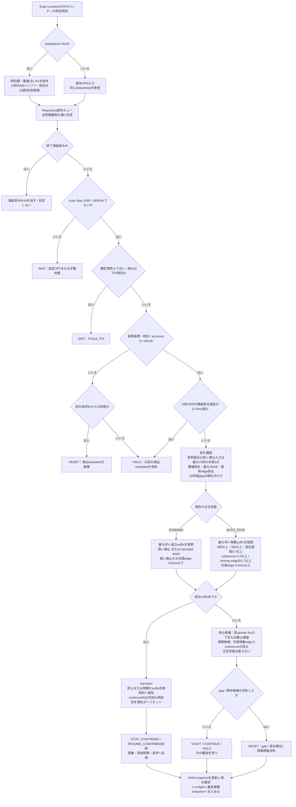
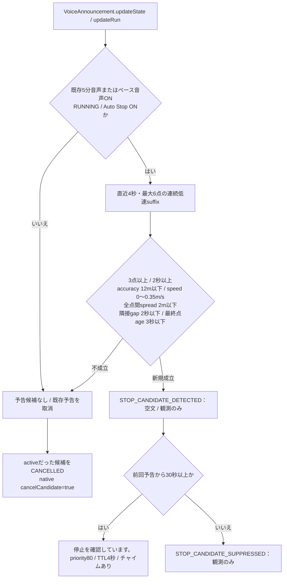
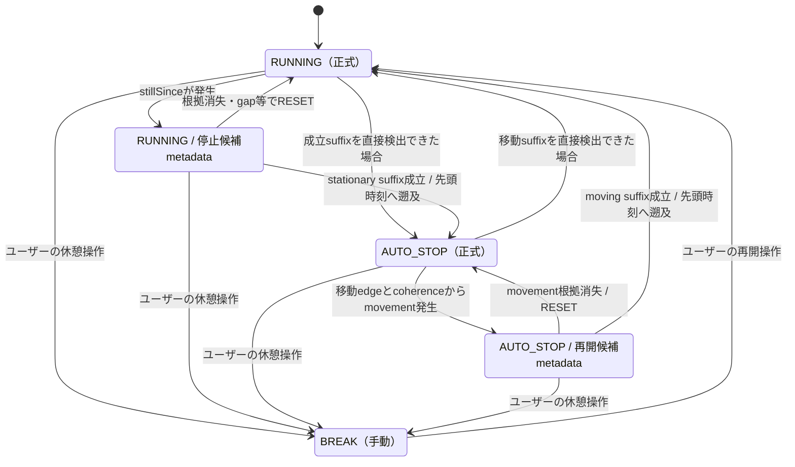
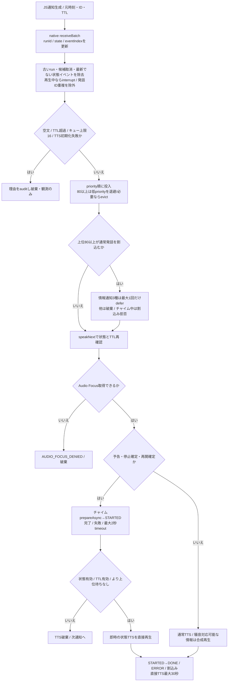

# Auto Stop：現行フローと設計レビュー資料（#43）

対象コード：Test v21実走時72f82b4系、現行332edff。今回の実装でAuto Stopの閾値・状態遷移・通知文言・優先度は変更していない。以下の「現行」と「改善候補」は別物。#38の目標達成時のRUN終了はこの停止/再開判定とは独立する。

## 1. 入力から確定まで（現行）

根拠：[ingestLocationBatch](../src/tasks/location-task.ts)、[RunRepository.appendActiveObservations/appendActivePoints](../src/repositories/run-repository.ts)、[GpsObservationSession.ingest](../src/utils/gps-observation.ts)、[detectStop](../src/utils/run-model.ts)、[inferMovement](../src/utils/movement-inference.ts)。

注：5秒は窓の観測期間であり、「5秒候補を作った後にさらに5秒待つ」実装ではない。RUNNING中のstillSince、AUTO_STOP中のmovementは候補metadataで、正式RunStateの追加状態ではない。サンプル時刻とJS受信・計算時刻は区別される。

### 音声の停止予告は別判定

[stopHint](../src/domain/voice-guidance.ts) と [updateGuidance](../src/services/voice-announcement.ts) は、正式detectStopとは別に直近RAM観測を調べる。正式停止の前提条件ではない。

## 2. 状態遷移（現行）

BREAK中のsensorイベントでは再開しない。正式transitionは同一状態、無効時刻、最後のイベントより古い時刻、機能OFFの遷移を拒否。確定時刻と有効開始時刻を分け、停止区間を距離・実走時間から除く。Raw GPSは削除しない。

## 3. 閾値・成立・取消（現行）

| 対象 | 条件・継続 | 不成立/取消・注意 |
|---|---|---|
| GPS品質 | 有限時刻/座標、緯度±90/経度±180、accuracy 0〜20m | 不良fixは15秒以内HOLD、超過RESET。GNSS speed欠損や0自体は正式判定の拒否条件ではない |
| 古いfix | 最終イベントのconfirmedAt以上、前良好fixより新しい | 古いfixはSKIP |
| jump | 隣接変位速度12.5m/s以下 | gapでないとき超過fixはHOLDし、前良好位置を置き換えない |
| 窓 | 原則10秒、疎な入力は最大15秒末尾3点、最大256点 | Testのlive RAM自体は10秒。15秒超gapは1点に戻す |
| 共通coverage | 5秒以上、2点以上、全edge有限かつ12.5m/s以下 | 不成立なら確定しない |
| 狭い静止 | spread≤3m AND 始終点変位/期間≤0.35m/s | 先頭edge≤0.5m/sも必要。speedMedianをAND条件にはしていない |
| bounded dwell | 8秒以上、5点以上、spread≤8m、変位速度≤0.35m/s、coherence≤0.35、movingではない | 先頭edgeの低速制約は免除。往復する小範囲の位置ぶれも静止の証拠にする |
| moving | 5秒以上、3点以上、変位速度≥0.7m/s、coherence≥0.7、0.5m/s以上のedgeがceil(edge数×0.7)以上 | 先頭edge≥0.5m/s。GNSS speed/中央値の下限、停止アンカーからの絶対10m移動は要求しない |
| 停止候補metadata | RUNNING窓spread≤3m、または窓のstationary推論 | 根拠消失はDISPLACEMENT_TOO_LARGEでRESET |
| 再開候補metadata | AUTO_STOP窓中、後続edge≥0.5かつsuffix coherence≥0.7となる先頭点 | 候補消失はMOVEMENT_TOO_SMALLでRESET |
| 音声予告 | 2〜4秒suffix、3点以上、accuracy≤12、speed≤0.35、spread≤2、最終age≤3秒、隣接gap≤2秒 | 正式停止より厳しい別条件。30秒cooldown、成立解除でcancel |

coherence = 始終点距離 / 総edge長。spread = 全点対の最大距離。移動速度は座標由来、GNSS speed中央値は診断値。`RUN_CONTROL.resumeDistance=10`・resumeSpeed=1.2・resumeFixes=2等は残存する旧detectStopV3用であり、現行v4の再開AND条件として読まない。旧版再現テストと現行テストは別。

## 4. チャイム・TTS・キュー（現行）

根拠：[VoiceAnnouncement.updateGuidance](../src/services/voice-announcement.ts)、[VoicePolicy](../modules/run-announcer/android/src/main/java/app/runjourney/announcer/VoicePolicy.kt)、[RunAnnouncerService.receiveBatch/speakNext/playChime/interrupt](../modules/run-announcer/android/src/main/java/app/runjourney/announcer/RunAnnouncerService.kt)。

| 通知 | 発行根拠 | 優先度 | 元TTL | チャイム |
|---|---|---:|---:|---|
| STOP_CANDIDATE_DETECTED/CANCELLED/SUPPRESSED | 音声用stopHintの成立/解除/cooldown | 80/100/80 | 4秒 | 空文の観測のみ、鳴らない |
| STOP_CANDIDATE_ANNOUNCED | 新規hint、30秒cooldown通過 | 80 | 4秒 | run_candidate →「停止を確認しています。」 |
| AUTO_STOP_CONFIRMED | sensor AUTO_STOPイベント | 100 | 確定fix＋15秒 | run_stop →「走行タイマーを一時停止しました。」 |
| AUTO_RESUME_CONFIRMED | sensor RUNNINGイベント | 100 | 確定fix＋15秒 | run_resume →「走行再開を検知しました。走行タイマーを再開します。」 |
| BREAK / RESUME | userの状態イベント | 100 | 操作時刻＋15秒 | なし、TTSのみ |

- 情報通知はFIVE_MINUTES/KILOMETER_LAP/PACE_WARNINGの3種。同種の古い待機情報は新しいものへ置換。deferはTTLをその時点から120秒へ変更し、最大1回再試行。元の文言をそのまま再読せず、120秒以内の最新recovery payloadへ統合する。停止中のdeferは「RUNNINGになるまで待つ」ゲートではなく、状態通知後に停止中でも最新総量を読む経路がある。
- チャイム再生中は原子的に完了待ち。状態変化や終了が来ても途中で止めず、完了後にTTSの有効性を再確認。音声を待ってRUNの保存/停止を遅らせない。
- 予告TTSは確定通知で割り込める。両者が短時間に連続することはあり得る。予告の音声成功は正式停止の条件ではない。
- 情報の騒音連動はTTSを一時WAVへ合成しMediaPlayerで再生する。合成timeout3〜8秒/prepare timeout2秒/再生timeout45秒。11/1の長文timeout修正（Test v23）は1文字60ms・最短3秒/最長8秒。失敗時は直接TTSへfallback。生マイク音声の保存ではない。チャイムと状態TTSは直接経路。Auto Stopの判定・通知仕様は変更していない。
- 重複ID保持はJS/native各最大2,048。nativeで旧runが終了済みなら後着の非終了batchを拒否。失効は再生前に検査し、チャイム後にも検査する。STARTED/DONEはOS再生コールバックで、聴取保証ではない。

## 5. 停止中に再開を誤判定し得る経路（現行からの推論）

1. 停止中でも座標が同じ方向へ滑ると、5秒以上で変位速度≥0.7・coherence≥0.7・移動edge比≥0.7を満たせる。accuracyは各fixの許容値であり、変位が位置誤差を有意に上回ることを検定しない。GNSS speed=0でも再開を拒否しない。
2. 再開を確定すると窓は現在点へ戻る。その後の座標が狭い範囲に静止すれば、再び5秒の静止でAUTO_STOPとなる。停止/再開後の専用cooldownや最小RUNNING継続時間はないため、座標ドリフト→静止を繰り返すと正式状態も往復し得る。
3. 音声予告はaccuracy≤12/spread≤2/speed≤0.35という独立ゲートなので、正式停止（accuracy≤20、dwell spread≤8）に達しても予告自体が成立しない。成立しても30秒cooldown、取消、TTL、上位通知、Audio Focus/TTS障害で聴こえない可能性がある。

これらはコード上の到達可能性。各実走時の身体の動きをログだけで確定するものではない。

## 6. 10月31日12.136km実走との比較

原ログは私有保全先のみ。JST 06:38:59〜08:06:29、保存GPS968点、正式イベント44件（停止22/再開22）。停止はnarrow-stillness15件、bounded-dwell7件。予告候補10件、予告音声7件、cooldown抑制3件、候補取消10件。予告7件は全てCHIME_STARTED/COMPLETEDを記録し、TTSは6件が状態変化で中断・1件DONE。停止チャイム22/再開チャイム22も全件開始/完了を記録。これは物理的に聴こえた証拠ではない。

GPS→JS配送p50/p95/max=66/391/1,831ms、Repositoryキュー0/1/7ms、判定3/5/55ms。保存checkpoint5393/7074/7646msは長いが、今回キュー滞留は支配要因ではない。nativeキュー→チャイム51/82/100ms（51件）。停止TTS528/786/869ms、再開535/769/772ms。物理停止時刻は不明で、GPS低速を代理値とする。

特に06:59:56、07:54:12、07:54:38は、GNSS speed中央値0でも座標条件が成立して再開。例07:54:38は5.001秒/6点、変位5.143m、座標速度1.028m/s、coherence0.962、moving edge比1.0。現行条件どおりの再開だが、ユーザー報告の停止中ドリフト疑いと照合すべき箇所。身体が停止していたと断定しない。

### 実記録の全正式遷移（座標は掲載しない）

| JST | 判定 | 窓秒 | 点数 | GNSS速度中央値 m/s | 座標変位速度 m/s | coherence | 静止証拠 |
|---|---|---:|---:|---:|---:|---:|---|
| 6:42:29 | STOP_CONFIRMED | 8.999 | 10 | 0.24342001974582672 | 0.281 | 0.324 | bounded-dwell |
| 6:42:39 | RESUME_CONFIRMED | 5.003 | 6 | 1.3299375772476196 | 2.732 | 0.999 | none |
| 6:42:54 | STOP_CONFIRMED | 5.001 | 6 | 0.08112013339996338 | 0.081 | 0.815 | narrow-stillness |
| 6:43:24 | RESUME_CONFIRMED | 5.059 | 6 | 1.807193398475647 | 2.551 | 0.982 | none |
| 6:44:47 | STOP_CONFIRMED | 5.000 | 6 | 0.4699999988079071 | 0.301 | 0.495 | narrow-stillness |
| 6:44:52 | RESUME_CONFIRMED | 5.000 | 6 | 0.6600000262260437 | 0.900 | 0.976 | none |
| 6:44:57 | STOP_CONFIRMED | 5.000 | 6 | 0.41999998688697815 | 0.271 | 0.512 | narrow-stillness |
| 6:45:02 | RESUME_CONFIRMED | 5.002 | 6 | 0.7900000214576721 | 0.857 | 0.736 | none |
| 6:45:11 | STOP_CONFIRMED | 8.998 | 10 | 0.3700000047683716 | 0.073 | 0.099 | bounded-dwell |
| 6:45:35 | RESUME_CONFIRMED | 5.000 | 6 | 2.1583917140960693 | 2.918 | 0.714 | none |
| 6:52:41 | STOP_CONFIRMED | 5.000 | 6 | 0.75 | 0.134 | 0.534 | narrow-stillness |
| 6:52:48 | RESUME_CONFIRMED | 7.002 | 8 | 0.699999988079071 | 0.874 | 0.874 | none |
| 6:53:02 | STOP_CONFIRMED | 5.001 | 6 | 0 | 0.296 | 0.521 | narrow-stillness |
| 6:53:09 | RESUME_CONFIRMED | 5.999 | 7 | 0 | 0.963 | 0.762 | none |
| 6:53:17 | STOP_CONFIRMED | 8.000 | 9 | 0.6700000166893005 | 0.220 | 0.201 | bounded-dwell |
| 6:53:22 | RESUME_CONFIRMED | 5.000 | 6 | 2.2300000190734863 | 2.475 | 0.990 | none |
| 6:58:12 | STOP_CONFIRMED | 5.061 | 6 | 0.5075204968452454 | 0.023 | 0.153 | narrow-stillness |
| 6:58:25 | RESUME_CONFIRMED | 7.000 | 8 | 0.4300000071525574 | 0.708 | 0.889 | none |
| 6:59:40 | STOP_CONFIRMED | 6.000 | 7 | 0.24906940758228302 | 0.281 | 0.981 | narrow-stillness |
| 6:59:56 | RESUME_CONFIRMED | 8.002 | 9 | 0 | 0.715 | 0.827 | none |
| 7:00:04 | STOP_CONFIRMED | 5.001 | 6 | 0 | 0.217 | 0.614 | narrow-stillness |
| 7:00:09 | RESUME_CONFIRMED | 5.000 | 6 | 2.200000047683716 | 2.015 | 0.928 | none |
| 7:32:18 | STOP_CONFIRMED | 8.038 | 9 | 1.9154757261276245 | 0.276 | 0.126 | bounded-dwell |
| 7:32:24 | RESUME_CONFIRMED | 6.000 | 7 | 2.184061050415039 | 2.515 | 0.999 | none |
| 7:45:15 | STOP_CONFIRMED | 5.001 | 6 | 0.8220860958099365 | 0.190 | 0.878 | narrow-stillness |
| 7:45:38 | RESUME_CONFIRMED | 5.000 | 6 | 2.1700000762939453 | 2.195 | 0.994 | none |
| 7:46:53 | STOP_CONFIRMED | 8.001 | 9 | 0.5179446339607239 | 0.138 | 0.183 | bounded-dwell |
| 7:47:08 | RESUME_CONFIRMED | 5.061 | 6 | 0.0551459826529026 | 1.657 | 0.962 | none |
| 7:47:15 | STOP_CONFIRMED | 6.000 | 7 | 0.3700000047683716 | 0.299 | 0.587 | narrow-stillness |
| 7:47:35 | RESUME_CONFIRMED | 7.001 | 8 | 0.5199999809265137 | 0.867 | 0.919 | none |
| 7:49:48 | STOP_CONFIRMED | 5.000 | 6 | 0 | 0.167 | 0.506 | narrow-stillness |
| 7:50:04 | RESUME_CONFIRMED | 8.001 | 9 | 1.2100000381469727 | 0.723 | 0.707 | none |
| 7:53:29 | STOP_CONFIRMED | 6.000 | 7 | 0.11566092073917389 | 0.095 | 0.667 | narrow-stillness |
| 7:53:37 | RESUME_CONFIRMED | 6.000 | 7 | 0.4099999964237213 | 0.895 | 0.775 | none |
| 7:53:45 | STOP_CONFIRMED | 8.000 | 9 | 0 | 0.266 | 0.227 | bounded-dwell |
| 7:54:12 | RESUME_CONFIRMED | 5.000 | 6 | 0 | 0.896 | 0.790 | none |
| 7:54:20 | STOP_CONFIRMED | 8.000 | 9 | 0 | 0.197 | 0.231 | bounded-dwell |
| 7:54:38 | RESUME_CONFIRMED | 5.001 | 6 | 0 | 1.028 | 0.962 | none |
| 7:58:31 | STOP_CONFIRMED | 5.000 | 6 | 0.33482739329338074 | 0.221 | 0.794 | narrow-stillness |
| 7:58:41 | RESUME_CONFIRMED | 5.000 | 6 | 1.7780870199203491 | 2.391 | 0.954 | none |
| 7:59:26 | STOP_CONFIRMED | 5.000 | 6 | 0.10181182622909546 | 0.194 | 0.673 | narrow-stillness |
| 7:59:36 | RESUME_CONFIRMED | 5.000 | 6 | 1.7893829345703125 | 3.118 | 0.996 | none |
| 8:00:07 | STOP_CONFIRMED | 5.001 | 6 | 0.3519379198551178 | 0.183 | 0.581 | narrow-stillness |
| 8:00:13 | RESUME_CONFIRMED | 5.999 | 7 | 0.6561736464500427 | 2.055 | 0.981 | none |

## 7. 改善候補（未実装・設計レビュー待ち）

| 候補 | 狙い | トレードオフ / 判断点 |
|---|---|---|
| A. 再開へGNSS speed/複数fixの一致を追加 | 座標だけの一方向ドリフトを抑制 | speed欠損/0に強い現行の利点を失い、低速歩行や再開検出が遅れる。速度の信頼性・取得可能なspeedAccuracyをどう扱うか |
| B. 停止アンカーと位置誤差に対する有意な変位を要求 | 4〜6mの偽移動を抑制 | 都市部でaccuracyが広いと真の再開も遅れる。固定距離か精度連動か、実ログで評価が必要 |
| C. 再開確認窓/最小状態継続/ヒステリシスを追加 | 短周期の往復を抑制 | 真の短停止・再開を潰し、距離/実走時間の遡及にも影響。チャイムだけの抑制とは分離して判断 |
| D. 予告と正式停止の根拠・取消理由をUIで一体表示 | 「予告なしで確定」の理由を理解しやすくする | 判定を揃えると予告増加/誤予告。確定は遅らせず、予告が間に合わない場合は省略する案との比較 |
| E. チャイムとTTSの通知設計を簡素化 | 予告→確定の連続音声を減らす | 状態の分かりやすさと案内量の交換。予告はチャイムのみ/確定はTTSのみ等はユーザー承認後に検討 |

レビュー事項：停止中と判明している実走時刻の指定、許容する再開遅延、歩行の扱い、短停止を記録したい最短時間、予告を必須にするか、予告と確定の音の分担。数値の採用や通知変更は一切行わず、ここで設計レビュー待ちとする。

## Test v24（11月5日実走向け）の同期

通知の文言・情報構成・優先度・TTL・GPS判定は上記と同じ。チャイムの再生準備CHIME_PREPARING、現在時刻のGENERATED診断を追加。情報音声の騒音補正は連続カーブへ変更、fallback通常TTSには開始時の相対音量だけを指定し、発話中の追従はできない。疲労PoCは履歴での明示ONのみで音声通知は追加しない。変更と検証限界は[field-20261105-readiness.md](field-20261105-readiness.md)を参照。設計候補は引き続き未承認。
