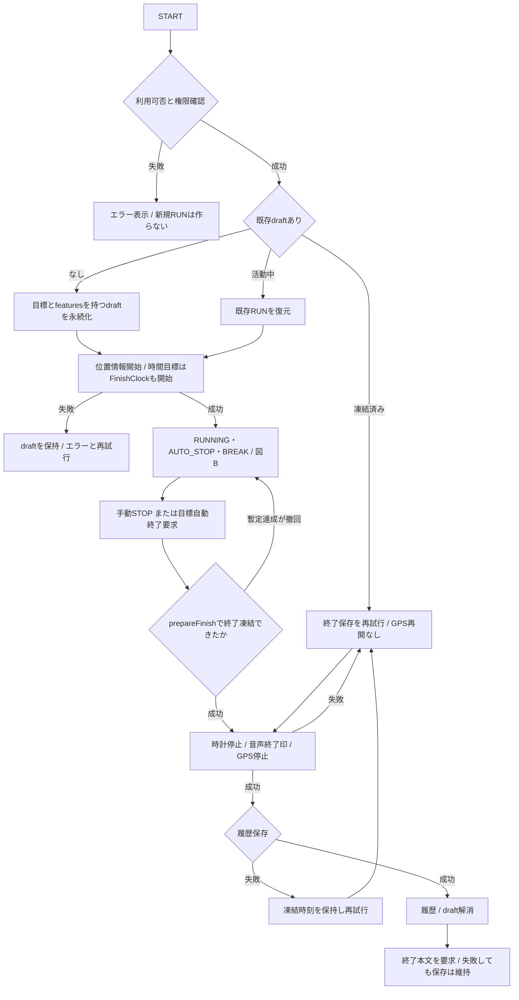
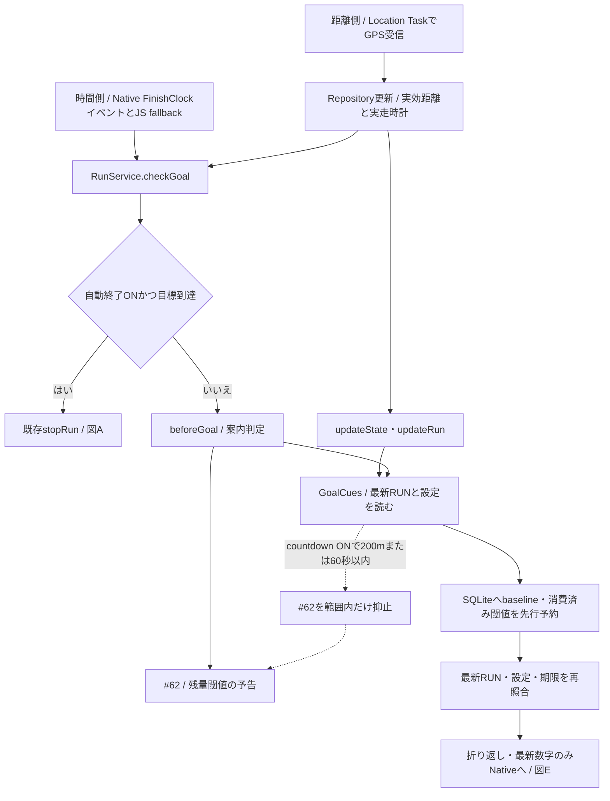
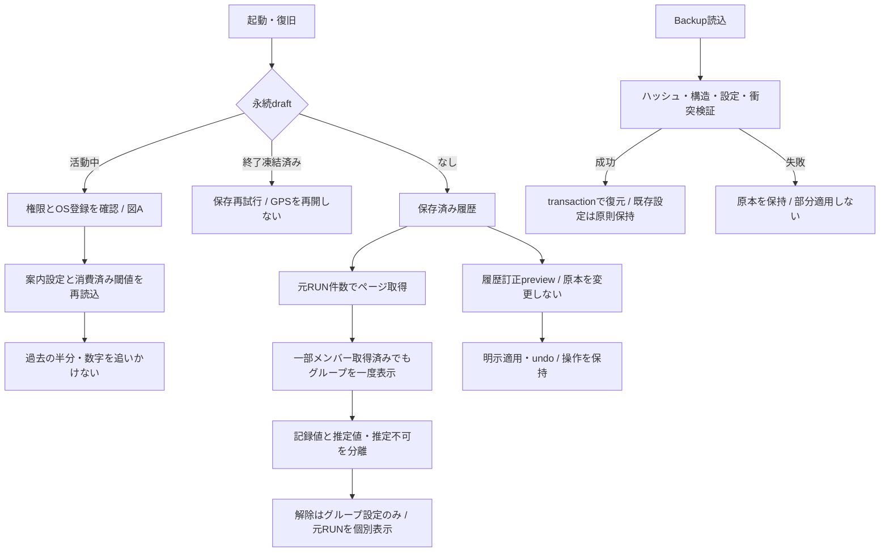

# RunJourney フロー・仕様・検証の索引

照合基準：Test v28 / PR #70 HEAD `f1476f7947779b0fa4aeb28a054efd44255ef0c8`。照合日：2026-11-10。本資料変更はレビュー用Draftであり、アプリ仕様変更・リリース承認ではない。

## 版と正本

- Test v26：PR #67 HEAD `ae701b3c79955df709bf7fef1ba7ae5c29f5267b`。共通チャイム、ペース走1km目標差、履歴グループ境界修正を含む。
- Test v28：上記へ#68/#69、開始TTLと本文watchdogの分離、Native pulse試聴とlock昇格を追加。主修正 `faadf6c2e618091ac21b63b2f88c44196bb2d28d`、指定HEADは記録追記を含む。
- 2026-11-10照合時点でPR #67/#70はいずれもDraft・未マージ。リモートmainは `626f4bef8bc0f8f5bfa85351df38cf18e6389bee`。main、Production variant、導入済みProduction APKは同一概念ではない。
- 導入済みProduction APKの最新ソース対応は未確認。Test資料の仕様・成功件数をProductionの実装・受入結果へ転記しない。Production/Paceへの変更は今回行わない。
- 同一ソース内でもTestは `app.runjourney.mobile.test` の高頻度GPS経路・診断UIを使用する。共有Nativeコードがあることを「導入済みProductionにも反映済み」と解釈しない。

正本の役割：

- 本資料：図A/D/Fと全体の案内。図中の保存処理名は説明用で、RunStateへの追加ではない。
- [Auto Stopフロー](auto-stop-flow-20261031.md)：図B/C、正式検出、独立した音声停止予告。数値条件の正本。
- [音声仕様マトリクス](voice-matrix-20261031.md)：図E、発火・文言・priority・開始期限・取消の正本。
- [検証マトリクス](verification-matrix-v28.md)：ケースID、テスト名、実行記録、実機・実走の確認範囲。
- [資料更新ルール](documentation-maintenance.md)：PRごとの更新判定と証跡管理。
- [更新比較・確認記録](flow-matrix-update-review-20261110.md)：変更前後、残課題、今回の品質確認。

日付付き資料は当時の証跡であり、最新版仕様を上書きする正本ではない。[v26](field-20261107-v26.md)、[v27導入・失敗とv28追記](goal-cues-20261109.md)、[v28画面OFF調査](goal-cue-screenoff-20261109.md)を参照。旧正本全文は[フロー旧版](archive/auto-stop-flow-before-v28.md)・[音声旧版](archive/voice-matrix-before-v28.md)へ保存した。

## 図A：RUN全体

根拠：[RunService](../src/services/run-service.ts) startRunOnce/restoreActiveRun/stopRun、[Repository](../src/repositories/run-repository.ts) prepareFinish/finishActiveRun。検証：RUN-01/RUN-02/GOAL-01。

STARTの同時呼出しはstartInFlightへ合流。新規draftの永続化後にGPS等の起動が失敗しても消去しない。STOPはstopInFlightへ合流し、凍結後の後着GPSで終了を延長しない。STOP UIの長押しと保存処理は別層。復旧の実際の再試行でもGPS停止確認を含む既存stopRun経路を通る。

## 図B：活動中の状態遷移

[Auto Stopフローの図B](auto-stop-flow-20261031.md#2-図b活動中の状態遷移)を参照。正式RunStateはRUNNING/AUTO_STOP/BREAK。停止・再開候補はmetadataであり、別の正式状態ではない。IDLEはactive draftなし、終了凍結は保存ライフサイクルで表す。

## 図C：GPS入力と実効値

[Auto Stopフローの図C](auto-stop-flow-20261031.md#1-図cgps入力から確定実効値まで)を参照。観測の採否、保存間引き、検出、距離edgeの採否を区別する。「不良入力を判定に使わない」と「元の保存GPSを書き換える」は別。

## 図D：目標判定と目標案内

根拠：[finish-goal](../src/domain/finish-goal.ts) goalAchievement、[Location Task](../src/tasks/location-task.ts) ingestLocationBatch、[FinishClock](../src/services/finish-clock.ts)、[目標案内](../src/services/goal-cues.ts) evaluateCueSource。検証：GOAL-01/CUE-01/CUE-02/CUE-03/CUE-04。

manual/distance/timeは排他的な単一目標。距離＋時間の複合目標は未実装・対象外。音声の成功・失敗・watchdogは終了判定を延期しない。時間目標はAUTO_STOP/BREAKの除外後の実走時間を使う。時間終了deadlineによる音声取消はRUN保存を実行する処理ではない。

目標変更ではgoal revisionと変更回数epoch、設定変更ではversionを再照合する。A→B→Aでも消費済み案内を再読せず、旧epochの後着要求を拒否する。復旧・新設定ON時に既に通過した半分や数字はbaselineで消費する。予約後クラッシュは重複再生より欠落を許すat-most-once方針。

## 図E：音声通知ライフサイクル

[音声正本の図E](voice-matrix-20261031.md#図e音声通知ライフサイクル)を参照。RUN状態図から分離し、開始TTL、本文watchdog、取消条件を同じ図で区別する。仕様上の順序とOS/TTSの配送遅延は別。

## 図F：復旧と保全

根拠：[SQLite](../src/repositories/sqlite-store.ts)、[Backup](../src/repositories/sqlite-backup.ts)、[履歴表示](../src/domain/history-list.ts)、[グループ](../src/domain/history-groups.ts)、[訂正](../src/utils/run-recovery.ts)。検証：REC-01/HIST-01/HIST-02/DATA-01。

グループは元RUNの結合保存ではない。主距離・平均速度は記録値、空白補間は詳細の推定値。0〜300秒の隣接間隔と元GPS観測速度12.5m/s上限を検査し、未知は0でなくnull。解除でGPSや元イベントを編集しない。

## previewと実RUNの責務境界

実RUN：距離はLocation Task、時間はFinishClockから、ユーザーDBの最新RUNを評価する。probe：Test限定の合成ActiveRunと別の`:memory:` SQLiteで同じ評価関数を使う。Native pulse試聴はJS interval fallbackなし、約22秒で終え、preview lease/lockは最大30秒。途中で実RUNを見つけたらprobe配送を止める。Nativeのpreview→実RUN lock昇格の自動試験と、JSを含む実機切替の受入は別（GAP-05）。

原本、設定、グループ、ごみ箱、保護情報の一致確認は[検証記録DATA-01/PROBE-01](verification-matrix-v28.md)を参照。室内probe成功をOSの実GPS配送や屋外聴取成功へ一般化しない。
