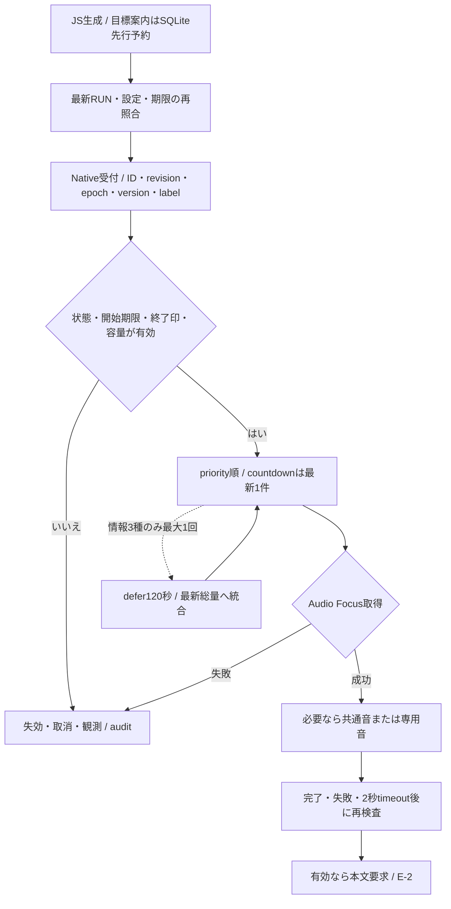
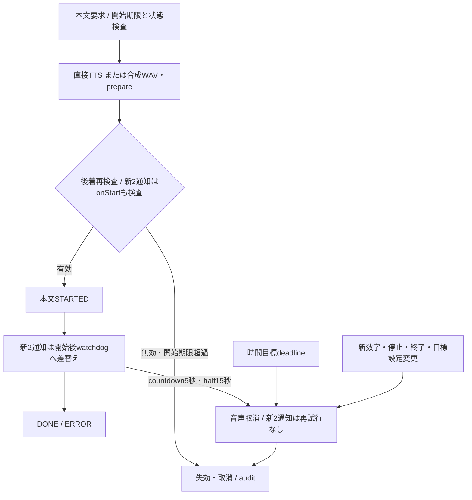

# 音声仕様マトリクス（Test v28正本・資料レビュー用Draft）

対象：PR #70 HEAD `f1476f7947779b0fa4aeb28a054efd44255ef0c8` / Test v28、照合日2026-11-10。Test v26 `ae701b3`の共通チャイム・1km目標差と、#68/#69・v28開始TTL修正を本文へ統合した。PR #67/#70はDraft・未マージ。Productionの導入済みAPKへの反映を意味しない。

本資料は通知仕様の正本であり、合格一覧ではない。[フロー索引](run-flow-index.md)、[Auto Stopの図B/C](auto-stop-flow-20261031.md)、[検証ケースと実機の区別](verification-matrix-v28.md)を参照。旧本文・当時のSHA・全追記は[旧正本全文](archive/voice-matrix-before-v28.md)へ保全した。5節の過去実走と6/7節の未実装提案は最新仕様と区別する。

## 1. 共通の読み方・コード根拠

- [VoiceAnnouncement/updateGuidance](../src/services/voice-announcement.ts)：機能ON/OFF、イベント作成、文言、TTL、priority、ID、JS側の生成抑制。
- [voice-guidance](../src/domain/voice-guidance.ts)：1kmラップ、貯金/遅れ、音声用停止予告、復旧文とsnapshot。
- [pace-workout](../src/domain/pace-workout.ts)：FAST/ON_TARGET/SLOW/UNKNOWN、2回連続判定、30秒評価、最小音声間隔。
- [voice-format](../src/utils/voice-format.ts)：5分案内の項目選択と文言。[finish-voice](../src/domain/finish-voice.ts)：保存済みRUNの終了サマリー。
- [VoicePolicy](../modules/run-announcer/android/src/main/java/app/runjourney/announcer/VoicePolicy.kt)、[RunAnnouncerService](../modules/run-announcer/android/src/main/java/app/runjourney/announcer/RunAnnouncerService.kt)：native queue、状態有効性、defer/recovery、TTS/chime、Audio Focus、失効/割込み。
- [CurrentTimePolicy](../modules/run-announcer/android/src/main/java/app/runjourney/announcer/CurrentTimePolicy.kt)、[ClockSettingsRepository](../src/repositories/clock-settings.ts)：現在時刻と独立設定。
- [RunAnnouncerModule](../modules/run-announcer/android/src/main/java/app/runjourney/announcer/RunAnnouncerModule.kt)：旧API互換、騒音プレビュー、native入口。

「5分音声ON」はvoice-announcement、「ペース音声ON」は走行開始時のpaceWorkout.voice。状態通知/予告はこのどちらかがONなら対象になる。現在時刻は別設定で、現在時刻だけをONにしても既存音声は有効にならない。START/#62/新2通知は上記の5分/ペース設定とは独立した規則を持つ（2節）。音声は指定Android nativeビルドで実装され、iOS/webは発話しない。

## 2. 全機能マトリクス（現行）

文中のX/D/T等は実データで置換される。句読点も各formatterに従う。空文イベントを実際の発話と混同しない。

| 機能 / type | 発火・判定条件 | 実際の読み上げ文言 / 情報項目 | 設定 | priority / 元TTL | 停止中・抑制・競合・失効 |
|---|---|---|---|---|---|
| 停止予告 / STOP_CANDIDATE_ANNOUNCED | RUNNING/Auto Stop ON、2秒以上3fixの独立stopHint。精度12m/速度0.35/spread2m等。30秒cooldown | チャイムrun_candidate→「停止を確認しています。」。状態確認のみ | 5分音声またはペース音声、Auto Stop | 80 / 4秒 | AUTO_STOP/BREAK、候補解除、古いrunで無効。確定100はTTSを割込む。チャイム中は完了待ち、完了後に古いTTSを捨てる |
| 停止確定 / AUTO_STOP_CONFIRMED | sensor AUTO_STOPイベント。最新eventIndexと現在AUTO_STOPを要求 | run_stop→「走行タイマーを一時停止しました。」。時計の状態 | 上と同じ | 100 / confirmedAt＋15秒 | 停止中に発話。再開や新状態で無効/割込み。情報通知をdefer。候補の発話成功は前提でない |
| 自動再開 / AUTO_RESUME_CONFIRMED | sensor RUNNINGイベント。最新eventIndex/現在RUNNING | run_resume→「走行再開を検知しました。走行タイマーを再開します。」 | 上と同じ | 100 / confirmedAt＋15秒 | 停止状態に戻れば無効/割込み。情報をdefer。チャイムは原子的 |
| 手動休憩 / BREAK | user BREAKイベント、Break機能ON、最新eventIndex/現在BREAK | 「休憩します。」。チャイムなし | 5分音声またはペース音声、Break | 100 / 操作時刻＋15秒 | BREAK中に発話。次の状態で無効。情報通知と競合時は上位 |
| 手動再開 / RESUME | user RUNNINGイベント、最新eventIndex/現在RUNNING | 「走行タイマーを再開します。」。チャイムなし | 上と同じ | 100 / 操作時刻＋15秒 | 古い状態で無効。自動再開との文言/チャイム差あり |
| 1kmラップ / KILOMETER_LAP | effectiveEdgesが整数kmを通過、確定active clock以下。最大200ラップ。境界を補間 | 「Xキロを通過しました。今回のラップは目標よりT早かったです/遅かったです。合計では目標よりT早いです/遅いです。」。今回と累積は別計算。丸めた絶対差0秒は目標どおり。目標比較なしではラップ時間のみ | ペース音声ON（5分音声とは独立） | 70 / 境界壁時刻＋30秒 | 同種待機は新情報で置換。停止/上位通知でdefer、最大1回復旧。境界距離・ラップ時間と最新復旧情報は別。5分通知と重複し得る |
| 5分案内 / FIVE_MINUTES | 有効実走時間の完了5分ラップ、確定済みclockで境界を算出。遅れたcallbackは元境界をTTLに使用 | 項目順は「X分です。総走行距離D。直近5分間でD。1キロM分S秒ペース。時速Vキロメートル。フルマラソンH時間M分ペースです。」。選択OFF/無効値は省略。ペース・速度・換算は直近5分ラップ | 5分音声ON、VoiceItems6項目。初期は時間/総距離ON、他OFF。ラップ30m未満はラップ項目を抑制 | 40 / 境界壁時刻＋20秒 | 同種置換、停止/上位でdefer。nativeは停止中の最新総量復旧を許容。既存内容OFFで空文なら観測のみ。1km/ペース/終了と重複 |
| ペース逸脱/復帰 / PACE_WARNING | 下表のFAST/SLOW/ON_TARGET。30秒評価・2回連続、最小60〜600秒（初期120秒） | FAST/SLOWは累計貯金/遅れ文、適正復帰は「目標ペースに戻りました。」。現在ペース数値、目標値、差分の読み上げはない | ペース走ON、ペース音声、目標ペース/許容幅/音声最小間隔 | 20 / notice.at＋20秒 | paused/UNKNOWNは生成しない。既生成情報は状態100/hint80でdefer/最大1回復旧する。最小間隔は毎分必ず読むタイマーではない |
| ペース走目標到達 / WORKOUT_GOAL | 未到達からsegmentの距離/有効時間目標に到達。pausedなら発話しない | 「ペース走の目標に到達しました。記録は継続します。」。到達状態のみ | ペース走/音声ON。#38のRUN自動終了とは別 | 60 / notice.at＋20秒 | 最小音声間隔とは独立して生成可。情報3種に含まれずdefer再試行しない。終了110が同時なら競合/破棄し得る |
| RUN終了 / RUN_GOAL_FINISHED | 手動/目標自動終了の保存成功後。終了済みRUNから作成 | 「走行を終了しました」または「目標に到達し、走行を終了しました」。続いて距離、実走時間、平均時速、平均ペース、完了1kmラップ本数/最後のラップ、お疲れさまでした。距離30m未満/時間0では速度・ペースなし | 5分音声またはペース音声。現在時刻のみONでは終了サマリーを追加しない | 110 / 生成＋30秒 | ended状態で唯一有効な通常batch種。その他を取消・割込む。共通チャイムは取消可、専用状態チャイムは完了後に旧本文を再検査。保存失敗なら成功案内しない。平均値はRUN全体の実走時間 |
| 現在時刻 / CURRENT_TIME（第2件） | RUN開始から5/10/15/30分の壁時計経過境界。Android native tick | 「現在、午前7時35分です」等。端末ローカルの午前/午後・時・分だけ。午前0時は「午前12時0分」 | 独立ON/OFF、初期OFF/10分 | 30 / 境界処理＋5秒 | AUTO_STOP/BREAK・発話中・待機キュー・TTS未準備・5秒超遅配はその境界を消費。まとめ読み/再試行なし。発話直前に現在時刻を生成。RUN終了や状態変更で破棄 |
| 情報復旧 / deferredの元typeを維持 | 5分/1km/ペースが状態通知/予告で中断・保留。最新recoveryが120秒以内 | 「保留していた走行情報です。実走行T時点で、総走行距離D。ここまでの平均は1キロTペースです。目標よりT早いです/遅れています。」。30m未満は平均なし、targetなしは貯金なし | 元通知の設定。専用スイッチなし | 待機の実効順位75 / defer時点から120秒 | 3種を一つの最新総量へ統合し、元のラップ時刻/内容を再読しない。最大1回。状態音声後、停止中も読める。古いrecoveryは破棄。CURRENT_TIMEはこの復旧に含めない |
| 音声通知テスト / LEGACY | 設定画面の音声通知をテスト | formatAnnouncementの20分/総距離3.2km/直近826.73mの固定例、選択項目に従う | テスト操作、VoiceItems。実RUNではない | 40 / 20秒 | 既存キューで発話。空文は発話なし。ended batch中では無効。履歴作成なし |
| 騒音追従プレビュー / LEGACY | 騒音ON、明示操作、マイク許可、可視Activity。20秒測定lease、2.5秒後にテスト音声 | 「騒音に合わせた音量のテストです。周囲が騒がしくなると案内の音量を少し上げ、静かになるとゆっくり戻します。音量は端末の設定が上限です。」 | 騒音設定ON、プレビュー操作 | 40 / 発行＋20秒 | 初期化/Focus/再生失敗時は診断。RUN履歴なし。生マイク音声は保存しない。端末stream音量は変更しない |
| 開始 / RUN_STARTED | draft永続化・位置情報開始成功後。復元/再試行も同じID | 実適用の目標・自動終了・Auto Stop・開始時の時刻設定 | 5分/ペース音声とは独立 | 60 / 元RUN開始＋30秒 | 共通チャイム。ID重複排除、GPS開始失敗で生成なし。再読なし |
| 終了前予告 / GOAL_WARNING（#62） | 自動終了ON、初期残500m/60秒。閾値は設定可能 | 残量と延長時の目標変更案内 | 5分/ペース音声とは独立 | 60 / 生成＋15秒 | 共通チャイム。停止/終了・旧目標で無効。countdown ONの200m/60秒内のみ抑止。範囲外は維持、OFFは従来どおり |
| 折り返し / TURNAROUND（#68） | 自動終了ON単一目標の50%を原則1回。距離50m/時間15秒を超える遅い通過はskip | 距離半分のキロ、時間半分の分と折り返しの目安 | 専用turnaround、初期OFF | 60 / 本文開始まで8秒、距離fixから最大5秒 | 共通チャイム。開始後15秒watchdog、時間目標deadlineを優先。停止/終了/旧epoch・設定で取消、情報復旧なし |
| 終了前数字 / GOAL_COUNTDOWN（#69） | 距離200〜10m/時間60〜10秒。ceil残量10単位の最新未消費数字だけ | 「残りXメートル/秒」 | 専用countdown、初期OFF | 60 / 本文開始まで3秒、距離fixから最大5秒 | 初回予約だけ共通チャイム、以後なし。開始後5秒watchdog。新数字/停止/終了/旧epoch・設定で取消、再試行なし |

### 観測専用・互換入口

- STOP_CANDIDATE_DETECTED/CANCELLED/SUPPRESSEDは空文。priority/TTLを持ってbatchへ送られてもOBSERVATION_ONLYとなり、チャイム/TTSは発行しない。VOICE_GENERATED、PACE_EVALUATION、STOP_PIPELINE、NOISE_*、RUN_GOAL_CHANGED、RUN_COMPLETIONも診断であり発話ではない。
- 旧binary用fallbackはnotifyBatchがないときだけ：transition(eventKey)で「停止しました」「休憩します」「走行を再開します」、updateAnnouncementで5分文、updateWorkoutでペース文。旧nativeはworkoutAllowed/期限/20秒クールダウン/5分通知の前後20秒・音声中・キュー中を抑制し、LEGACY priority40へ渡す。指定Test v28ではnotifyBatch経路を使用する。
- VoiceAnnouncement.achieved(runId,message)は終了priority110/TTL30秒の互換入口だが、現行アプリに呼出元なし。[achievementMessage](../src/domain/finish-goal.ts)の「目標のXキロメートル/分に到達しました。計測を終了しました。お疲れさまでした。」も現行終了時は呼ばれず、finishVoiceを使用。未使用文言を実走で発火する機能として数えない。

## 3. ペース3条件の横並び比較（現行）

| 観点 | 速い FAST | 適正 ON_TARGET | 遅い SLOW |
|---|---|---|---|
| 判定 | 現在ペース < 目標−許容秒 | 目標±許容秒の範囲内（境界を含む） | 現在ペース > 目標＋許容秒 |
| 窓/確定 | 直近約30秒の良好保存GPS、再開後30秒以上、25秒以上/5点以上、移動の整合性、30秒評価で2回連続 | 同左 | 同左 |
| 発火 | 最小間隔を満たせば継続FASTでも通知 | 直前の案内状態がFAST/SLOWから戻った場合だけ。適正が続いても定期通知しない | 最小間隔を満たせば継続SLOWでも通知 |
| 文言生成 | savingsMessage(累計貯金秒) | 「目標ペースに戻りました。」 | savingsMessage(累計貯金秒) |
| 正の累計貯金 | 「目標よりX分Y秒早いです。」 | 貯金額は読まない | 同じく「目標よりX分Y秒早いです。」になり得る |
| 負の累計貯金 | 「目標よりX分Y秒遅れています。」になり得る | 遅れ額は読まない | 「目標よりX分Y秒遅れています。」 |
| ほぼ0 | 「累計の貯金と遅れはありません。」 | 同上の復帰文のみ | 同左の累計0文 |
| 読む数値 | RUN全体の累計貯金/遅れ | 数値なし | RUN全体の累計貯金/遅れ |
| 読まない数値 | 今のペース、目標ペース、許容差、現在の差分 | 同左＋累計貯金/遅れ | FASTと同じ |
| 停止/品質不良 | UNKNOWNで新規生成なし | 同左 | 同左 |
| 優先度/TTL/割込み | 20/20秒、状態でdefer/最新総量へ復旧 | 同左 | 同左 |

現在ペース = 実走/品質ゲートを通過した短期窓、累計貯金 = 目標秒/km×総km−実走秒。この2つは異なる時間窓。**FASTとSLOWの文言生成構造自体は同じ**で、FASTだから必ず「早い」と読む実装ではない。一方、適正復帰は数値なしという非対称性がある。ユーザーが聞いた情報差は、累計の符号、同時の1km/5分通知、defer後の復旧文も突き合わせる必要がある。

## 4. 共通キュー・TTL・失効・音声経路

- priorityは終了110→状態100→停止予告80→復旧待機75→1km70→目標系60（開始/#62/折り返し/countdown/ペース目標）→5分40→現在時刻30→ペース20。復旧75はspeakNextの並べ替え時だけの実効順位で、元priorityを上書きしていない。
- キュー上限16、重要通知80以上には下位evict経路あり。空文/初期化失敗/元TTL超過/古い状態は破棄。ID重複保持は各2,048件。同種の情報待機は新情報へ置換。
- 高優先度80以上は下位TTSを割込む。情報3種だけ最大1回deferし、期限120秒と最新総量recoveryへ置換。元の古いラップ文は後追いしない。現在時刻は再試行しない。
- 共通チャイムは通常通知に300ms＋間隔180ms。同じ通知のretryでは繰り返さない。共通音は状態取消・終了・既存shouldPreemptで割込可。専用音は停止候補/自動停止/自動再開で、完了待ち・最大2秒。完了後に状態/TTL/競合を再確認する。手動BREAK/RESUMEはチャイムなし。通常通知同士のpriority差だけでは共通チャイム後の本文を破棄しない。
- Audio FocusはTRANSIENT_MAY_DUCK、失敗は破棄。直接TTS最大30秒。騒音測定が有効で情報3種/LEGACY/終了/開始/#62/折り返しなら合成WAV＋MediaPlayer（合成3〜8秒/prepare2秒/再生45秒）、失敗は直接TTSへ戻る。11/1の実走で長文の固定3秒timeoutを確認し、Test v23で1文字60ms・最短3秒/最長8秒へ修正。WORKOUT_GOAL、状態、現在時刻は直接経路。
- bodyEligibleで本文要求・合成完了・MediaPlayer準備完了・直接TTS要求の前に期限/状態を検査する。v28の新2通知は直接TTS onStartでも開始期限を検査し、開始済み本文には別watchdogを設定する。旧「合成後にTTLを再検査しない」という説明はv26以降へ適用しない。
- native Audio Focus変化listenerは現状処理なし。Bluetooth切替/実際の音圧/聴取はcallback成功だけでは判定できない。第1件ではfallback理由と再生中gain/route、上限等の診断を拡充した。

## 5. 実走ログとの対応

10月31日対象RUN：Pace42 STARTED/42 DONE、1km12/12、5分16 STARTED/14 DONE、終了1/1、ペース走目標1/1。予告7 STARTED中6は状態変化で中断、停止22/22、再開22 STARTED/21 DONE＋1中断。5分には再試行を含む合成TIMEOUT14件があり、16発話中13は直接TTS。1件のPace EXPIREDと、複数の情報defer/recovery/mergeを記録。単純な生成件数合算では同じ案内の再試行を二重計上するためID/元IDで比較する。

#48の元の「途中から聞こえない」問題について、このRUNにPace/1km/5分の後半発話が存在することと、案内構成の分かりにくさは別の評価軸。今回の現在時刻はv21には存在しない。追加後の実機確認と、10月31日実走の証拠を混ぜない。

## 6. 問題点と改善候補（未実装）

| 問題 | 候補A | 候補B | トレードオフ・レビュー論点 |
|---|---|---|---|
| 短期のFAST/SLOWなのに累計の早い/遅いを読む | 「現在ペース→目標との差→累計」の定型 | ペース案内は現在ペース/差だけ、累計はkm案内へ | Aは説明的だが長い。Bは短いが累計を把握しにくい。現在ペースと累計をどう呼び分けるか |
| 適正復帰だけ数値がない | 3条件全て同じ情報項目・順序 | 適正は短い復帰文、逸脱のみ数値 | 統一性と簡潔さの交換。適正の定期通知を追加するかも別に判断 |
| km/5分/復旧で時間窓が違う | 「今回1km」「直近5分」「ここまで平均」を毎回明示 | 通知種を整理して窓を統一 | 語数増加対、走行中の理解負荷。既存ラップ分析は変更せず発話だけ整理する案もある |
| kmと5分が重なり距離/ペース/貯金が重複 | 同時発火を一つの案内に構成 | 役割を分担して片方の重複項目を省略 | 統合時の優先度/TTL/途中中断/項目欠落を設計する必要 |
| 復旧文で元のラップ詳細が消える | 最新総量へ統合する現行を明示し継続 | 失われた情報種だけ短く補足 | 古い情報の後追いを防ぐ利点対、ラップ情報不足。元時刻の読み方も判断 |
| 終了は速度→ペース、5分はペース→速度 | 全機能を「時間→距離→ペース→補足」等へ統一 | 機能ごとの役割に合わせて維持 | 統一すると聞きやすいが慣れた順序が変わる。数値精度/0分0秒の読み方もレビュー |
| 予告と確定が連続・予告のTTSが中断 | 予告チャイムのみ | 確定のみ発話し予告を短音へ | Auto Stop設計資料と一緒に、必要な安心感と案内過多を判断 |
| 現在時刻が競合で省略される | 現行の即時見送りを維持 | 次の短い空きで新しい現在時刻だけ読む | Bは頻度と優先順位が変わる。古い時刻を保存して読む案は採用しない |
| 騒音補正が上限/直接TTSでは効かない | 状態/限界の診断と設定説明を充実 | ヘッドルーム/合成方法を別途PoC | 端末上限を無断で上げず、遅延・電池・聴取の実機比較が必要 |

## 7. ユーザー判断が必要な項目

1. FAST/適正/SLOWを同じ項目・順序にするか、適正のみ短くするか。
2. ペース通知で知りたいのは「今のペース」「目標との差」「累計貯金」のどれか、全てか。
3. kmと5分を併用するか、役割分担/統合するか。通知が重なった時に必ず残す情報は何か。
4. 停止中に最新総量の復旧案内を聞きたいか、再開後に限定するか。
5. 予告/確定/再開のチャイムとTTSの分担、終了サマリーの長さ、現在時刻を競合時に見送る扱い。

上記は旧設計レビューから持ち越した未実装の候補。今回の資料整理はこれらの機能変更を承認/実装しない。採用済みの共通チャイム・1km文言は2/4節の仕様を優先する。

## 8. v26からv28と過去記録の読み方

v26で共通チャイムと1kmの独立した区間/累積目標差を採用。1km/recoveryは可変計画区間を積分するが、複数区間controller/編集UIは未実装。既存終了目標の延長はペース値を変更しない。詳細は[field v26](field-20261107-v26.md)。

v28では新2通知の本文開始期限と完了watchdogを分離。時間目標deadline・次数字・停止・終了・旧目標/設定の取消は継続する。距離/時間のpreviewを実RUNの実走と同一視しない。[v27の失敗と導入記録](goal-cues-20261109.md)、[v28の画面OFF修正・室内結果](goal-cue-screenoff-20261109.md)、[過去の全追記](archive/voice-matrix-before-v28.md)を参照。

### 図E：音声通知ライフサイクル

根拠：receiveBatch/speakNext/playChime/bodyEligible/cueBodyStarted/interrupt。検証：VOICE-01/VOICE-02/CUE-05、追加不足はGAP-01/GAP-04。

#### E-1：生成から本文要求まで

共通音は300ms＋180ms間隔、専用音とは割込み条件が異なる。チャイム不要の通知は本文直前検査へ進む。通常通知同士のpriority差だけでは共通音後の本文を破棄しない。

#### E-2：本文開始・完了・取消

通常情報3種の取消時はE-1のdefer対象となり得る。「再試行なし」は新2通知の規則。新2通知以外には新しい5秒/15秒watchdogを適用しない。通常直接TTS30秒、合成再生45秒等の上限は4節のとおり。新2通知では本文開始前の期限監視を開始後の世代付きwatchdogへ差し替え、古い開始期限callbackで有効な本文を切らない。時間目標deadlineは常に上限。Nativeの取消は音声のみで、RUN保存は図A/Dの既存処理が担う。

### 予約・設定・復旧

新2スイッチは独立・初期OFF。Run IDをhashしたSQLite setting内に、目標種別/値/自動終了のrevision別進捗を最大64種類保存する。目標epochと設定versionで後着を拒否。新設定ON/初回復旧/新目標で既に過ぎた半分や数字は追わない。逆戻りでも消費済み閾値は再通知しない。予約後の失効/クラッシュで欠落し得るが、再通知による重複は避ける。

初回countdownの予約後に失効しても、後の数字で初回チャイムをやり直さない。通常情報3種のdeferと、新2通知のat-most-once予約は別の仕組み。65番目以降の未登録revisionはGOAL_LEDGER_CAPACITYとしてskipする（GAP-03は境界試験未実装）。
